# AXIOM DFIR: PHASE II IMPLEMENTATION PLAN

**Target**: Nebius x NVIDIA Global AI Hackathon 2026 (Best Apps & Agents Track)  
**Objective**: Transform AXIOM DFIR into an enterprise-grade, adaptive, scientifically evaluated autonomous DFIR platform.  
**Execution Strategy**: Systematic, incremental, test-driven enhancements preserving 100% of existing functionality.

---

## 1. Prioritized Work Breakdown Structure

### Priority 0 (Critical Architecture, Reasoning & Scientific Validation)

| Task ID | Component | File Path | Objective |
|---|---|---|---|
| **P0-1** | **Adaptive Investigation Engine** | `src/axiom_dfir/hypothesis.py`, `src/axiom_dfir/investigation_loop.py` | Implement structured `Hypothesis` schema, falsification-first reasoning, competing hypotheses, bounded investigation loop (max turns, budget, timeouts), and persisted `InvestigationLedger`. |
| **P0-2** | **Content-Addressed Storage & Chain of Custody** | `src/axiom_dfir/cas.py`, `src/axiom_dfir/chain_of_custody.py` | Build CAS abstraction with immutable snapshots, hash-chained audit logging (`previous_event_hash` -> `event_hash`), and Ed25519 manifest digital signature support. |
| **P0-3** | **Atomic Claim Validation Engine** | `src/axiom_dfir/atomic_claims.py`, `src/axiom_dfir/validation.py` | Upgrade claims to atomic `(Subject, Predicate, Object)` tuples with time scopes, explicit rule IDs, and human-readable validation explainability. |
| **P0-4** | **Intelligent Nebius/Nemotron Escalation** | `src/axiom_dfir/nebius.py` | Implement explainable escalation rules (`FAST` -> `BALANCED` -> `DEEP`) based on open hypotheses, evidence complexity, and conflicting indicators. |
| **P0-5** | **Scientific Benchmark Suite & Multi-Baseline Harness** | `scripts/evaluate_axiom.py`, `BENCHMARK_REPORT.md` | Build comparative evaluation measuring: (A) Rules Only, (B) Single Nemotron, (C) Multi-Model without Claim Gate, (D) Full AXIOM DFIR across precision, recall, FPR, FNR, latency, and cost. |

---

### Priority 1 (Data Standards, Provenance Graph & Investigator UX)

| Task ID | Component | File Path | Objective |
|---|---|---|---|
| **P1-1** | **Provenance Attack Graph & Causality Intelligence** | `src/axiom_dfir/correlation.py` | Typed graph entities, provenance-carrying edges, and strict distinction between temporal correlation (`OBSERVED_BEFORE`) and causal relationships (`SPAWNED`). |
| **P1-2** | **OCSF Security Event Normalization Layer** | `src/axiom_dfir/ocsf.py` | Map raw forensic artifacts into OCSF-compatible security event classes (Process Activity 1007, Network Activity 4001, Authentication 3002). |
| **P1-3** | **Interactive Finding Drill-Down & Workspace UX** | `src/axiom_dfir/web.py` | Enriched single-page application with finding drill-down modals, raw evidence viewer, active hypothesis progression, and live REST endpoints. |
| **P1-4** | **Optional Tavily Threat Intelligence Layer** | `src/axiom_dfir/threat_intel.py` | Enriches validated public IOCs (IPs, domains, hashes) via Tavily Search API when `TAVILY_API_KEY` is present, strictly separating external intelligence from local forensic facts. |

---

### Priority 2 (Production Hardening & Verification)

| Task ID | Component | File Path | Objective |
|---|---|---|---|
| **P2-1** | **Host Platform Compatibility (Windows/Linux)** | `src/sift_sentinel/tools/common.py`, `memory.py` | Add static fallback for Volatility plugin discovery when `vol` CLI is not present on host; normalize Windows path checks. |
| **P2-2** | **Comprehensive Testing & Validation** | `tests/test_axiom_*.py` | Add unit tests for hypothesis loop, atomic claims, CAS, chain-of-custody, OCSF, and Tavily enrichment. |
| **P2-3** | **Documentation Finalization** | `README.md`, `ARCHITECTURE.md`, `BENCHMARK_REPORT.md`, `PHASE_II_CHANGELOG.md` | Update all product and technical documentation to reflect Phase II implementation. |

---

## 2. Execution Sequence

```mermaid
flowchart LR
    A["P0-1: Adaptive Hypothesis Engine"] --> B["P0-2: CAS & Hash-Chained CoC"]
    B --> C["P0-3: Atomic Claim Validation"]
    C --> D["P0-4: Nebius Model Escalation"]
    D --> E["P1-1: Provenance Attack Graph"]
    E --> F["P1-2: OCSF Event Normalization"]
    F --> G["P1-3: Web Console Drill-Down"]
    G --> H["P1-4: Tavily Threat Intel"]
    H --> I["P0-5: Scientific Benchmark Harness"]
    I --> J["P2: Tests & Documentation Release"]
```

